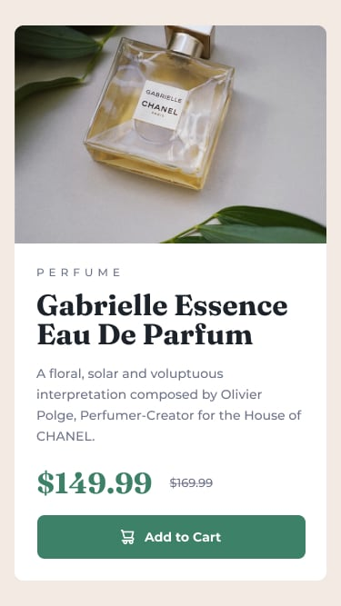
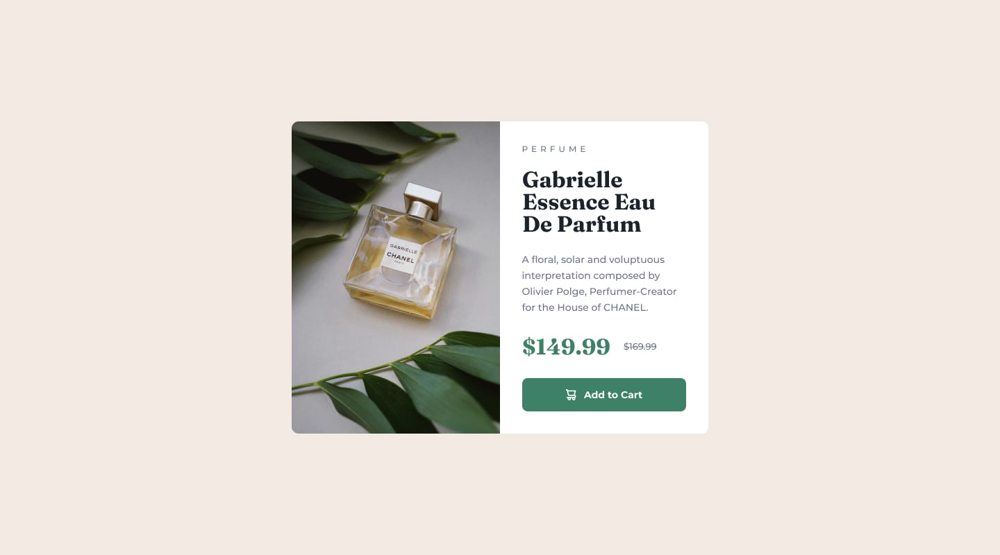

# Tarjeta de producto

Maqueta una tarjeta de perfume siguiendo las referencias. Conserva los textos en inglés y utiliza los recursos de la carpeta **images**.

## Tu tarea

1. Abre **index.html** con Live Server.
2. Organiza la tarjeta con la imagen, la categoría, el título, la descripción, los dos precios y el botón de compra.
3. Escribe los estilos en **style.css**.
4. Utiliza Flexbox para que la imagen y la información se coloquen una debajo de otra en una ventana estrecha y una al lado de la otra cuando haya espacio suficiente. Puedes apoyarte en **flex-wrap**.
5. Diferencia el precio actual del anterior, que aparece tachado.
6. Comprueba que la tarjeta se adapta al ancho disponible sin desplazamiento horizontal.

## Diseño esperado

### Diseño móvil



### Diseño ampliado



El resultado es aproximado. Ajusta los tamaños y espacios observando las referencias.

## Hoja de estilos

El HTML ya enlaza el archivo **style.css**, situado en la misma carpeta:

```html
<link rel="stylesheet" href="style.css">
```

## Colores de referencia

| Elemento | Color |
| --- | --- |
| Fondo de página | `#f2ebe3` |
| Fondo de tarjeta y texto del botón | `#ffffff` |
| Precio actual y fondo del botón | `#3c8067` |
| Categoría, descripción y precio anterior | `#6c7289` |
| Título | `#1c232b` |

## Tipografías

Las fuentes ya están enlazadas en el HTML:

- **Fraunces**, con grosor 700, para el título y el precio actual.
- **Montserrat**, con grosores 500 y 700, para los textos restantes.

## Recursos

- **images/image-product-mobile.jpg**: fotografía horizontal.
- **images/image-product-desktop.jpg**: fotografía vertical.
- **images/icon-cart.svg**: icono de carrito.

## Comprueba tu trabajo

- La imagen tiene una descripción alternativa y conserva sus proporciones.
- La tarjeta cambia de distribución según el espacio disponible.
- El contenido es legible y los precios se distinguen con claridad.
- El botón ocupa el ancho del bloque de información.

Ejercicio basado en el reto **Product preview card component** de Frontend Mentor.
